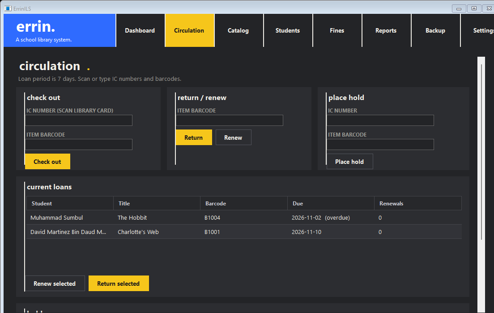
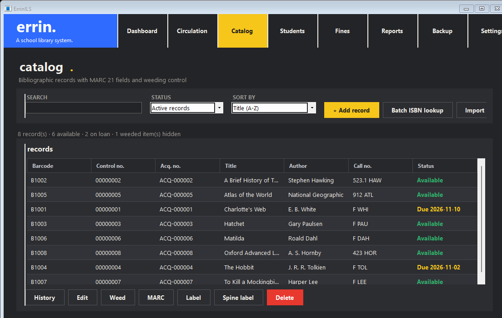
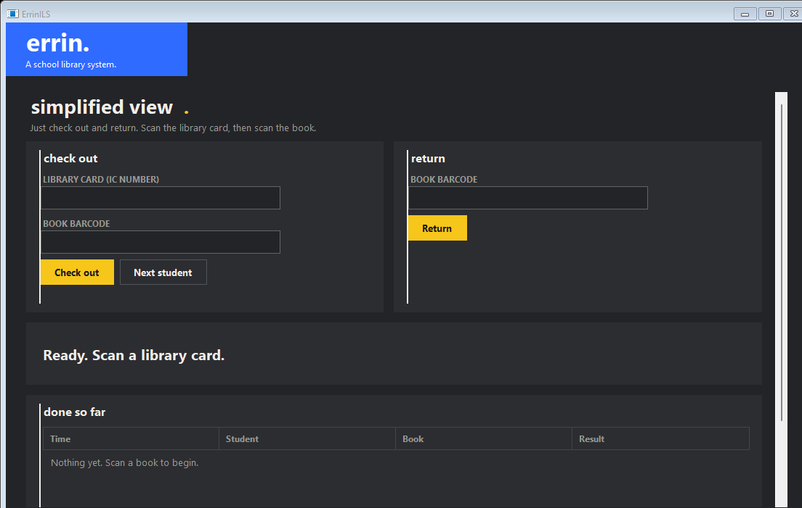
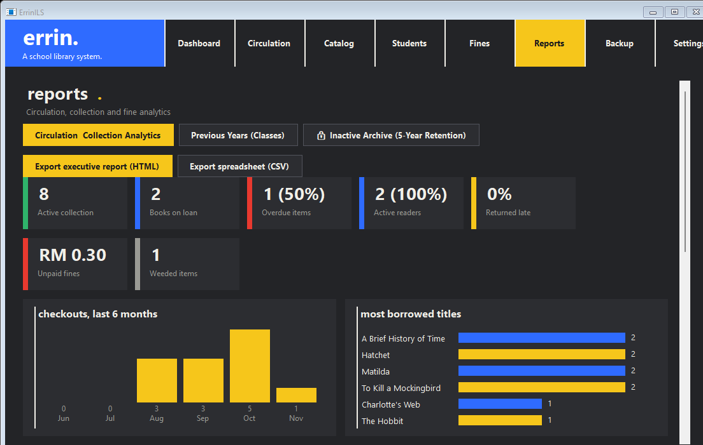
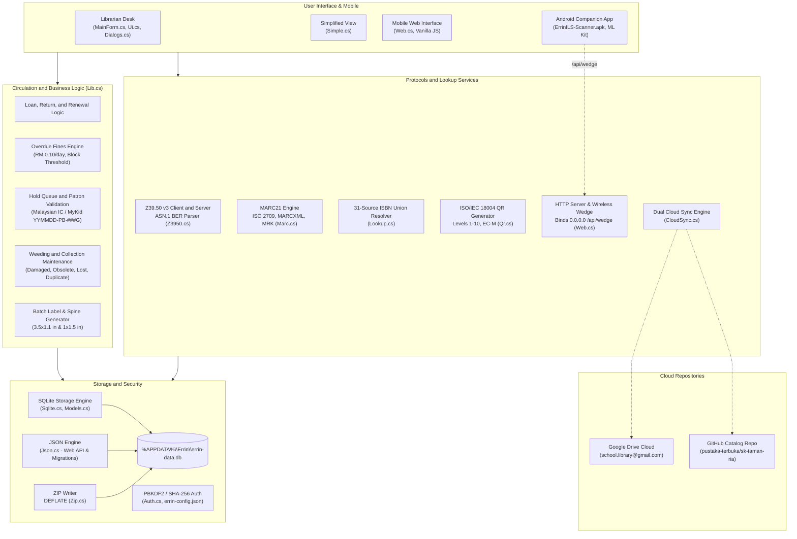

# ErrinILS

<p align="center">
  
</p>

<p align="center">
  <strong>Lightweight school library management system for Windows &amp; Android.</strong><br>
  Fast barcode circulation, 31-source union ISBN cataloguing, Android companion scanner APK, batch label printing, simplified student interface, and a high-performance SQLite database.
</p>

<p align="center">
  <a href="https://github.com/RZSY/ErrinILS/releases"></a>
  <a href="#system-requirements"></a>
  <a href="#system-requirements"></a>
  <a href="LICENSE"></a>
</p>

<p align="center">
  <a href="https://rzsy.github.io/ErrinILS/">Website</a> •
  <a href="https://github.com/RZSY/ErrinILS/releases">Releases</a> •
  <a href="docs/assets/ErrinILS-User-Guide.pdf">Official PDF Manual</a> •
  <a href="https://rzsy.github.io/ErrinILS/guide.html">User Manual &amp; Flowcharts</a> •
  <a href="AGENTS.md">Developer Guide</a> •
  <a href="#quick-start">Quick Start</a>
</p>

---

## Overview

ErrinILS is a zero-dependency school library management system (ILS) designed for standard Windows PCs and Android devices. Rather than requiring dedicated Linux servers, complex database administration, or web server setups like Koha or SLiMS, ErrinILS runs as a standalone executable on any computer running Windows 7 or newer, accompanied by a native Android scanning app.

It covers everyday school library operations: barcode checkouts and returns, copy-cataloguing across 31 Malaysian and international library databases, batch label and spine printing with multi-selection, simplified self-service mode for students, mobile stock audits over local Wi-Fi, and **bidirectional mobile scanner integration** (desktop port 8585, mobile listener port 8586). All library data is stored locally in a single SQLite database without external database drivers.

```text
                _       ___ _     ____  
  ___ _ __ _ __(_)_ __ |_ _| |   / ___| 
 / _ \ '__| '__| | '_ \ | || |   \___ \ 
|  __/ |  | |  | | | | || || |___ ___) |
 \___|_|  |_|  |_|_| |_|___|_____|____/ 
```

---

## Features

- **Custom Acquisition & Barcode Numbering Engine**: Format templates configured in Settings with full support for semantic and date tokens (`{0:D6}`, `######`, `000000`, `{NUMBER}`, `{NUMBER:6}`, `{YEAR}`, `{YYYY}`, `{YY}`, `{MM}`), custom sequence starting baselines, live real-time preview sample badges, and automatic collision-free regex parsing across existing catalog items.
- **Redesigned Wide Barcode Labels with Optional Parallel Call Numbers**: Barcodes span the full label width (240 units wide by 54 units tall) centered on the label to eliminate cramped, squished barcodes. Full-width title is rendered across the top, and Dewey Call Numbers can be optionally rendered parallel as a full-width horizontal row between the title and barcode (`labelShowCall`).
- **Comprehensive Fines & Overdue Holdings Tracking**: The Fines ledger includes students currently holding unreturned overdue books tagged with a crimson `Holding (Overdue)` badge. Features real-time accrued calculations (`daysOverdue × rate`), with 1-click librarian actions to **Pay** (settle fine and return book in one click), **Waive** (forgive fine and return book), or **Return** (check in book and assess fine for later payment).
- **Barcode Circulation**: Scan student IDs and book labels with instant visual feedback, automatic return dates, loan limit checks (default: 3 books for 7 days), and hold alerts.
- **31-Source ISBN Union Cataloguing**: Enter or scan an ISBN to automatically pull title, author, publisher, publication year, DDC, and subjects across 31 union archives: Pustaka Terbuka Union, KIK (National Union), PNM (Perpustakaan Negara Malaysia), all 14 State Public Libraries (Selangor, Penang, Perak, Kedah, Perlis, Johor, Kelantan, Terengganu, Pahang, Negeri Sembilan, Melaka, Sarawak, Sabah, KL, Putrajaya, Labuan), u-Pustaka, MALCat, Universiti Malaya (UM), UKM Tun Seri Lanang, UiTM PTAR, UPSI, Dewan Bahasa dan Pustaka (DBP), Library of Congress (Z39.50), Open Library, Google Books, HathiTrust, and K10plus German Union.
- **Batch Label & Spine Printing**: Select multiple items using `Ctrl+A`, Shift-click, or row selection. Print physical 3.5"×1.1" barcode labels or 1"×1.5" Dewey spine labels with live antialiased preview, copies-per-record selector, and print dialog.
- **Android Companion App (ErrinILS Scanner v1.4.3)**: Native Android app (Kotlin, Jetpack Compose, CameraX, Google ML Kit) with 2 primary librarian workflows: **Virtual Barcode Gun** (`/api/wedge` wireless keystroke streaming to PC) and **Mobile ISBN Cataloging** (camera ISBN lookup and accessioning). Available as `dist/ErrinILS-Scanner-v1.4.3.apk`.
- **Bidirectional PC-to-App Connectivity**: The desktop system can initiate connections to the Android phone (listening on port `8586`), measure ping latency, trigger remote haptic and audible alerts (*Beep Phone*), pair directly by IP address without typing a 6-digit PIN (*+ Connect Scanner by IP*), and auto-discover companion scanners across the local subnet.
- **Remote Access Copy-Cataloging**: Look up books by ISBN directly in the browser-based remote access interface (`Web.cs`) with 31-source search and direct one-click commits to the catalog.
- **Simplified View**: Interface designed for students and young readers. Features oversized buttons, clear visual status banners, and a dedicated exit button back to librarian controls.
- **Mobile Access and QR Pairing**: Built-in HTTP server (`0.0.0.0:8585`) serving a mobile web app. Pair a phone or tablet by scanning an on-screen QR code for cable-free shelf audits and inventory checks.
- **Automatic Self-Updater**: One-click updates with TLS 1.3 support, GitHub Releases integration, automatic detection of installer vs standalone portable binary, and bounded retry resilience.
- **School Localization**: Built-in Malaysian IC and MyKid validation (`YYMMDD-PB-###G`) with birthdate calendar checks, overdue fines calculated in Ringgit Malaysia (RM 0.10/day default), and Nilam reading reports.
- **SQLite Database Optimization**: All data persists in `%APPDATA%\Errin\errin-data.db` using high-performance ACID SQLite storage with WAL journaling. Includes built-in 1-click database vacuuming, integrity check, and JSON backups.
- **MARC21 and Z39.50 Protocols**: Built-in parsers and generators for binary ISO 2709 (`.mrc`), MARCXML (`.xml`), and MRK mnemonic (`.mrk`), with MARC-8 diacritic conversion and an ASN.1 BER Z39.50 v3 client and server.
- **High-DPI Display Support**: Native PerMonitorV2 awareness for sharp ClearType text and proper scaling at 125%, 150%, and 200% zoom.
- **Weeding and Collection Maintenance**: Track withdrawn copies with status reasons (condition/damage, obsolete, lost, duplicate) while retaining circulation statistics.
- **Direct Cloud Sync & Multi-PC Architecture**:
  - **User & Student Records (Google Drive Cloud)**: Private student records, active loans, fines, and borrowing history sync directly to Google Drive cloud (`school.library@gmail.com`) via zero-dependency HTTPS—no Google Drive desktop app or third-party background software required.
  - **Book & Catalog Records (Pustaka Terbuka Data Provider)**: Bibliographic catalog data syncs directly to the GitHub repository [`pustaka-terbuka/sk-taman-ria`](https://github.com/pustaka-terbuka/sk-taman-ria), structured according to the official Pustaka Terbuka Data Provider standard (PPAPP model) with canonical aliases (`data/aliases.jsonl`), partitioned MARCXML (`data/bib/`), holdings (`data/holdings/`), intake batches (`harvest/inbox/`), and standard convenience formats (JSON, CSV, `.mrc`, `.mrk`, `.xml`), ready for central indexing by [`pustaka-terbuka/opac`](https://github.com/pustaka-terbuka/opac). Supports both standard Git CLI and **zero-dependency direct HTTPS REST API pushing** (allowing school netbooks without Git installed to publish updates using a GitHub Personal Access Token).
  - **Multi-Station Support**: Any classroom or library PC running ErrinILS connects to the same cloud data for seamless multi-PC circulation and cataloging.

---

## Screenshots

<div align="center">

### Circulation Desk
*Barcode circulation with patron history, overdue status, fine calculation, and hold queue.*
<br>


<br><br>

### 5-Source ISBN Lookup
*Copy-cataloguing from Library of Congress, Open Library, Google Books, HathiTrust, and K10plus.*
<br>


<br><br>

### Simplified View
*Simplified full-screen view for student self-service checkouts and returns.*
<br>


<br><br>

### Reports and Analytics
*Circulation metrics, reader rankings, monthly trends, and collection breakdown.*
<br>


</div>

---

## Comparison

| Feature / Metric | ErrinILS v1.4.2 | Koha ILS | SLiMS (Senayan) | Excel / Spreadsheets |
| :--- | :--- | :--- | :--- | :--- |
| **Installation** | Single EXE or NSIS installer | Linux server + Perl modules | Apache + PHP + MySQL stack | Spreadsheet file only |
| **Dependencies** | 0 (.NET 4.0 runtime only) | Hundreds of CPAN packages | PHP, Apache/Nginx, MariaDB | Office suite |
| **RAM Footprint** | Under 30 MB RAM | 4 GB – 8 GB dedicated | 2 GB – 4 GB RAM | 200 MB – 500 MB |
| **Database** | Single SQLite database (`errin-data.db`) | MariaDB / MySQL + Zebra | MySQL / MariaDB | None (Flat tabular) |
| **ISBN Cataloguing** | Built-in 31-source union lookup | Z39.50 (server configuration needed) | P2P service / plugins | Manual typing |
| **Mobile Scanner Gun** | Android APK (CameraX ML Kit wedge) | Third-party mobile app | Third-party plugin | None |
| **Batch Label Printing** | Multi-select barcode & spine labels | Label creator tool | Barcode generator plugin | Custom mail merge |
| **Simplified View** | Built-in simplified student view | Separate self-checkout module | Third-party web plugin | None |
| **Malaysian IC / MyKid** | Native validation and birthdate check | Custom regex required | Custom script required | Manual formulas |
| **Cloud Synchronization**| Dual cloud: Google Drive & GitHub | Complex database replication | Manual SQL dumps | Cloud folder file share |
| **Hardware** | Runs on older PCs (1 GB RAM) | Modern server hardware | Dedicated web server PC | Modern desktop PC |
| **Backups** | 1-click ZIP archive or copy DB file | mysqldump and Zebra re-indexing | MySQL database export | Save copy of file |

---

## System Architecture

ErrinILS is structured into cleanly separated modules using only standard .NET Framework assemblies:



---

## System Requirements

| Component | Minimum Requirement | Recommended |
| :--- | :--- | :--- |
| **Operating System** | Windows 7 SP1 (32-bit or 64-bit) | Windows 10 or Windows 11 (64-bit) |
| **Companion App** | Android 7.0 (Nougat) with Camera | Android 10+ with CameraX & ML Kit |
| **Runtime** | Microsoft .NET Framework 4.0 | Microsoft .NET Framework 4.8 *(built into Windows 8+)* |
| **Processor** | 1.0 GHz x86/x64 | 1.8 GHz or faster |
| **Memory** | 1 GB RAM *(ErrinILS uses ~25-30 MB)* | 2 GB RAM or higher |
| **Storage** | 10 MB free space | 50 MB free space *(for catalog data and backups)* |
| **Display** | 1024 × 600 pixels | 1366 × 768 or higher (High-DPI supported) |
| **Peripherals** | Mouse and keyboard | USB keyboard-wedge barcode scanner or Android Companion App |
| **Network** | Offline *(No internet needed for circulation)* | Wi-Fi / LAN for mobile phone scanner and online ISBN lookups |

> [!NOTE]
> Windows 8, 8.1, 10, and 11 include .NET Framework out of the box. Windows 7 requires [.NET Framework 4.8](https://dotnet.microsoft.com/download/dotnet-framework/net48) installed once.

---

## Quick Start

### Option 1: Windows Installer
1. Download `ErrinILS-Setup-1.4.2.exe` from [Releases](https://github.com/RZSY/ErrinILS/releases).
2. Double-click the installer and follow the wizard steps.
   *(If Windows SmartScreen appears, click "More info", then "Run anyway".)*
3. Open ErrinILS from the Start menu or desktop icon.

### Option 2: Portable Standalone
1. Download `ErrinILS-Windows.zip` or the standalone `ErrinILS.exe`.
2. Extract or copy the file to any folder (or a USB flash drive).
3. Run `ErrinILS.exe`.

### Option 3: Android Companion App (ErrinILS Scanner)
1. Download `ErrinILS-Scanner-v1.4.2.apk` onto your Android phone or tablet.
2. Tap the APK to install (enable "Install unknown apps" if prompted).
3. In ErrinILS desktop, go to **Settings → Remote Access** and click **Pair New Device**.
4. Tap **Scan QR to Pair** in the mobile app, then use **Virtual Barcode Gun** to beam scanned barcodes directly into your PC's active cursor!

---

## Default Credentials and Settings

- **Default Administrator Password**: `admin123`
- **Protected Actions**: System Settings, record deletions, and backup restoration.
- **Change Password**: Go to **Settings** → enter `admin123` → set a new password.
- **Password Reset**: Close ErrinILS, delete `%APPDATA%\Errin\errin-config.json`, and restart the app. The password resets to `admin123`.

### File Locations
- `%APPDATA%\Errin\errin-data.db` — Main SQLite database (catalog items, patrons, active loans, holds, fines, class history, settings).
- `%APPDATA%\Errin\errin-config.json` — Configuration, password hash, and authorized mobile device tokens.

---

## Barcode Scanning & Navigation

ErrinILS is designed for fast, mouse-and-scanner workflows with standard USB and wireless barcode scanners operating in keyboard-wedge mode:

- **Barcode Processing (`Enter`)**: Standard barcode scanners automatically send an `Enter` key after scanning a barcode, instantly processing checkouts, returns, student lookups, and ISBN queries without pressing extra keys.
- **Circulation Desk Flow**: Scan a student barcode or IC number to load their profile, then scan book barcodes to check them out. To check in a book, scan its barcode in the Return box.
- **Simplified View**: Students scan their library card and book barcodes directly on screen. To return to librarian controls, click **Exit Simplified View** at the bottom of the screen.

---

## Mobile Access and QR Pairing

ErrinILS includes a built-in HTTP server (`0.0.0.0:8080`) that allows staff to access the catalog and perform stock audits from a smartphone or tablet:

1. Open **Settings** → **Remote Access & Device Pairing**.
2. Click **Pair New Device** to display a pairing QR code and 6-digit code.
3. Scan the QR code using a phone or tablet camera.
4. The browser opens the mobile web interface and pairs automatically using an authentication token (`X-Errin-Token`).

---

## Online Public Access Catalog (OPAC)

ErrinILS includes an **OPAC** (Online Public Access Catalog) for students, teachers, and parents:

- **Local Network OPAC**: Reachable by anyone on the school network at `http://<computer-ip>:8585/opac`.
- **Subject Heading & Multi-Token Search**: Search by title, author, call number, or dedicated **Subject Heading** (Perkara) to explore books by curriculum or topic.
- **Optional Patron Login**: Can be turned ON in **Settings** → **OPAC (Public Catalog)** (`db.Set.opacLogin`, OFF by default). When active, students log in with their Student ID or Malaysian IC (`no_pengenalan`) to check current loans, due dates, fines, reading history, and place holds on borrowed copies.

---

## Building from Source

ErrinILS targets .NET Framework 4.0 / C# 5 syntax and requires only base framework assemblies.

### Windows (csc.exe)

```powershell
& "C:\Windows\Microsoft.NET\Framework64\v4.0.30319\csc.exe" `
    /target:winexe `
    /optimize+ `
    /debug- `
    /win32icon:ErrinILS-source\icon.ico `
    /r:System.Drawing.dll,System.Windows.Forms.dll `
    /out:dist\ErrinILS.exe `
    ErrinILS-source\src\Json.cs `
    ErrinILS-source\src\Models.cs `
    ErrinILS-source\src\Sqlite.cs `
    ErrinILS-source\src\Marc.cs `
    ErrinILS-source\src\Z3950.cs `
    ErrinILS-source\src\Lib.cs `
    ErrinILS-source\src\Lookup.cs `
    ErrinILS-source\src\Zip.cs `
    ErrinILS-source\src\Auth.cs `
    ErrinILS-source\src\CloudSync.cs `
    ErrinILS-source\src\NetHelper.cs `
    ErrinILS-source\src\Qr.cs `
    ErrinILS-source\src\CertHelper.cs `
    ErrinILS-source\src\Updater.cs `
    ErrinILS-source\src\AssemblyInfo.cs `
    ErrinILS-source\src\Ui.cs `
    ErrinILS-source\src\Simple.cs `
    ErrinILS-source\src\Web.cs `
    ErrinILS-source\src\MainForm.cs `
    ErrinILS-source\src\Dialogs.cs `
    ErrinILS-source\src\Program.cs
```

### Linux and macOS (Mono)

```bash
cd ErrinILS-source
chmod +x build.sh
./build.sh
```

### Windows Installer (NSIS)

```cmd
makensis -V2 -DVERSION=1.4.2 ErrinILS-source\installer.nsi
```

---

## Repository Structure

```text
d:/errin/
├── AGENTS.md                     # Architecture specification
├── README.md                     # Repository documentation
├── README.txt                    # Plain-text user guide
├── LICENSE                       # MIT License
├── docs/                         # Documentation site and user guide
│   ├── index.html                # Overview page
│   ├── guide.html                # 19-chapter user manual & flowcharts
│   ├── about.html                # System architecture notes
│   ├── download.html             # Downloads and checksums
│   └── assets/                   # Screenshots and PDF manual
├── dist/                         # Compiled release packages
│   ├── ErrinILS-Setup-1.4.2.exe  # Windows installer
│   ├── ErrinILS-Windows.zip      # Portable ZIP archive
│   ├── ErrinILS-Scanner-v1.4.2.apk # Android companion APK
│   └── ErrinILS.exe              # Standalone executable
├── ErrinILS-Android/             # Native Android companion app
│   └── app/src/main/             # Kotlin Jetpack Compose & ML Kit
└── ErrinILS-source/              # C# source code
    ├── icon.ico                  # Application icon
    ├── installer.nsi             # NSIS script
    ├── build.sh                  # Mono build script
    └── src/                      # C# source files
        ├── Program.cs            # Entry point and High-DPI setup
        ├── Models.cs             # Data models (Item, Patron, Loan, Hold, Fine, Db)
        ├── Json.cs               # JSON parser and serializer
        ├── Lib.cs                # Circulation rules, fines, and IC validation
        ├── Lookup.cs             # 5-source copy-cataloguing
        ├── Marc.cs               # MARC21 parser and generator
        ├── Z3950.cs              # Z39.50 v3 client and server
        ├── Qr.cs                 # ISO/IEC 18004 QR code generator
        ├── Web.cs                # HTTP server and mobile web interface
        ├── Auth.cs               # PBKDF2 / SHA-256 password hashing
        ├── CloudSync.cs          # Direct Google Drive Cloud & GitHub multi-PC sync
        ├── NetHelper.cs          # Network interface discovery
        ├── Zip.cs                # DEFLATE ZIP archive writer
        ├── Ui.cs                 # WinForms UI controls and styling
        ├── MainForm.cs           # Primary librarian interface
        ├── Dialogs.cs            # Editor and label dialogs
        └── Simple.cs             # Simplified view interface
```

---

## License

ErrinILS is open-source software licensed under the [MIT License](LICENSE).
