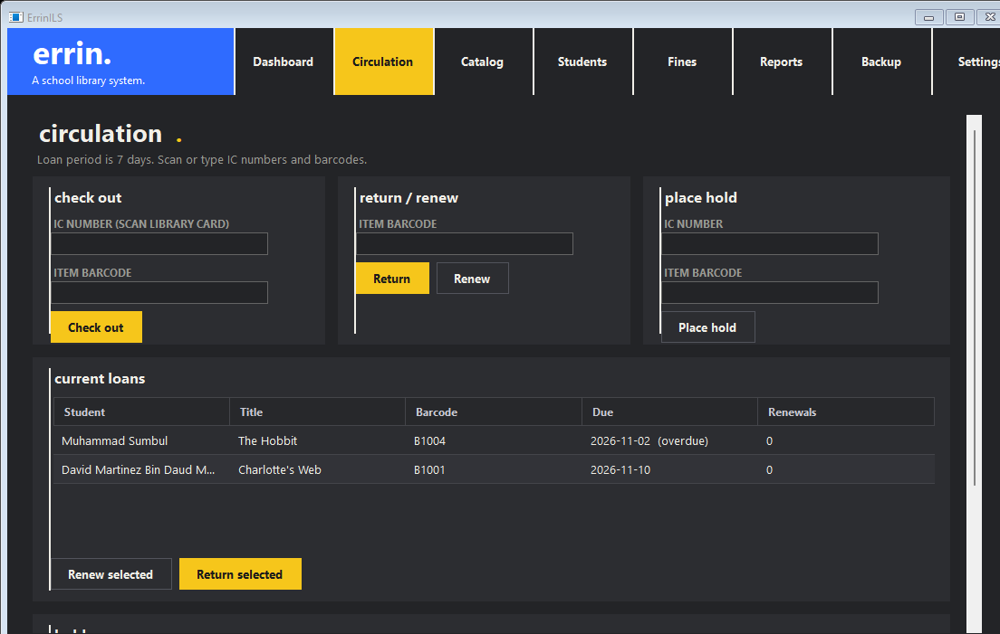
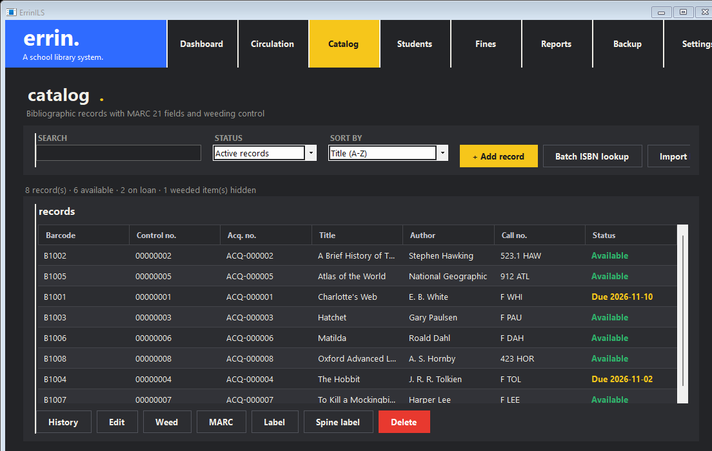
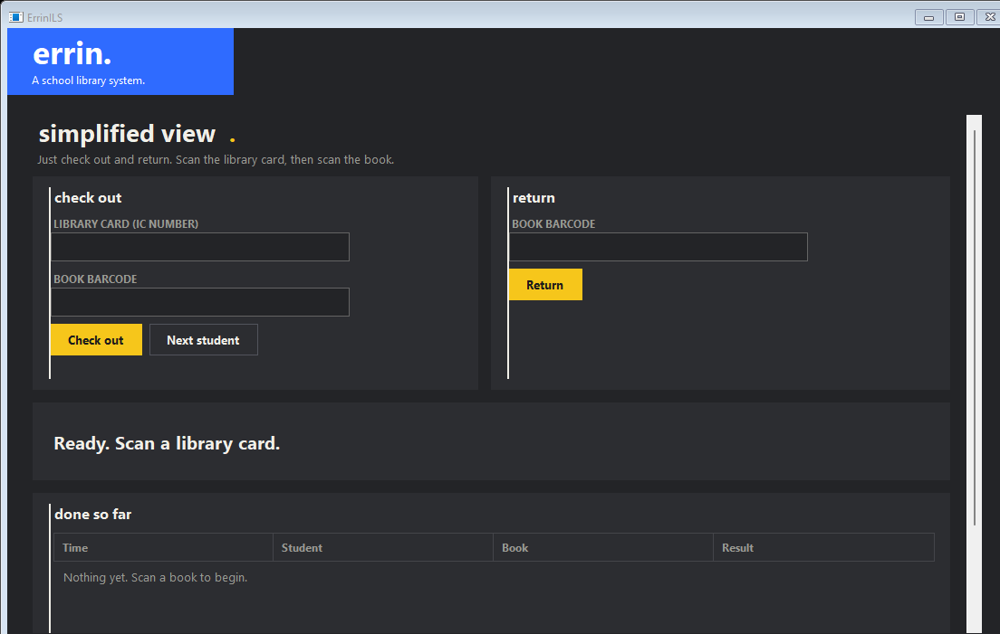
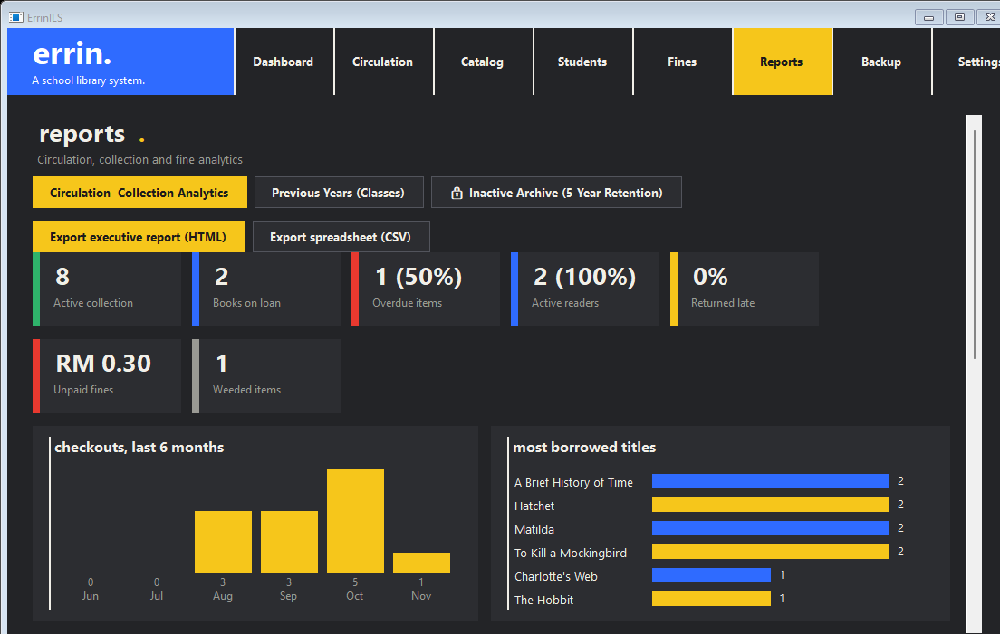
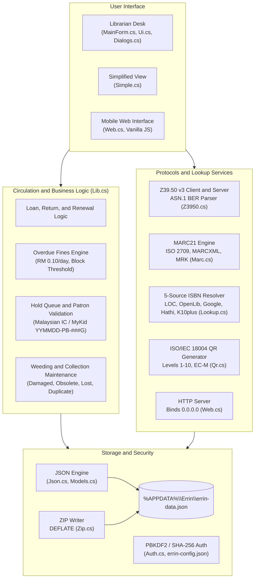

# ErrinILS

<p align="center">
  
</p>

<p align="center">
  <strong>Lightweight school library management system for Windows.</strong><br>
  Fast barcode circulation, 5-source ISBN cataloguing, simplified student interface, and an offline JSON database.
</p>

<p align="center">
  <a href="https://github.com/RZSY/ErrinILS/releases"></a>
  <a href="#system-requirements"></a>
  <a href="#system-requirements"></a>
  <a href="LICENSE"></a>
</p>

<p align="center">
  <a href="https://rzsy.github.io/ErrinILS/">Website</a> •
  <a href="https://github.com/RZSY/ErrinILS/releases">Releases</a> •
  <a href="docs/assets/ErrinILS-User-Guide.pdf">User Manual (PDF)</a> •
  <a href="AGENTS.md">Developer Guide</a> •
  <a href="#quick-start">Quick Start</a>
</p>

---

## Overview

ErrinILS is a zero-dependency school library management system (ILS) designed for standard Windows PCs. Rather than requiring dedicated Linux servers, complex database administration, or web server setups like Koha or SLiMS, ErrinILS runs as a standalone executable on any computer running Windows 7 or newer.

It covers everyday school library operations: barcode checkouts and returns, copy-cataloguing across international library databases, simplified self-service mode for students, and mobile stock audits over local Wi-Fi. All library data is stored locally in a single JSON database without external database drivers.

```text
                _       ___ _     ____  
  ___ _ __ _ __(_)_ __ |_ _| |   / ___| 
 / _ \ '__| '__| | '_ \ | || |   \___ \ 
|  __/ |  | |  | | | | || || |___ ___) |
 \___|_|  |_|  |_|_| |_|___|_____|____/ 
```

---

## Features

- **Barcode Circulation**: Scan student IDs and book labels with instant visual feedback, automatic return dates, loan limit checks (default: 3 books for 7 days), and hold alerts.
- **5-Source ISBN Cataloguing**: Enter or scan an ISBN to automatically pull title, author, publisher, publication year, and Dewey Decimal classification from Library of Congress (Z39.50), Open Library, Google Books, HathiTrust, and K10plus.
- **Simplified View**: Interface designed for students and young readers. Features oversized buttons, clear visual status banners, and a dedicated exit button back to librarian controls.
- **Mobile Access and QR Pairing**: Built-in HTTP server (`0.0.0.0:8080`) serving a mobile web app. Pair a phone or tablet by scanning an on-screen QR code for cable-free shelf audits and inventory checks.
- **School Localization**: Built-in Malaysian IC and MyKid validation (`YYMMDD-PB-###G`) with birthdate calendar checks, overdue fines calculated in Ringgit Malaysia (RM 0.10/day default), and Nilam reading reports.
- **JSON Database and ZIP Backups**: All data persists in `%APPDATA%\Errin\errin-data.json`. Includes a pure C# DEFLATE backup writer to create timestamped ZIP archives on USB flash drives.
- **MARC21 and Z39.50 Protocols**: Built-in parsers and generators for binary ISO 2709 (`.mrc`), MARCXML (`.xml`), and MRK mnemonic (`.mrk`), with MARC-8 diacritic conversion and an ASN.1 BER Z39.50 v3 client and server.
- **High-DPI Display Support**: Native PerMonitorV2 awareness for sharp ClearType text and proper scaling at 125%, 150%, and 200% zoom.
- **Weeding and Collection Maintenance**: Track withdrawn copies with status reasons (condition/damage, obsolete, lost, duplicate) while retaining circulation statistics.

---

## Screenshots

<div align="center">

### Circulation Desk
*Barcode circulation with patron history, overdue status, fine calculation, and hold queue.*
<br>


<br><br>

### 5-Source ISBN Lookup
*Copy-cataloguing from Library of Congress, Open Library, Google Books, HathiTrust, and K10plus.*
<br>


<br><br>

### Simplified View
*Simplified full-screen view for student self-service checkouts and returns.*
<br>


<br><br>

### Reports and Analytics
*Circulation metrics, reader rankings, monthly trends, and collection breakdown.*
<br>


</div>

---

## Comparison

| Feature / Metric | ErrinILS v1.3.2 | Koha ILS | SLiMS (Senayan) | Excel / Spreadsheets |
| :--- | :--- | :--- | :--- | :--- |
| **Installation** | Single EXE or NSIS installer | Linux server + Perl modules | Apache + PHP + MySQL stack | Spreadsheet file only |
| **Dependencies** | 0 (.NET 4.0 runtime only) | Hundreds of CPAN packages | PHP, Apache/Nginx, MariaDB | Office suite |
| **RAM Footprint** | Under 30 MB RAM | 4 GB – 8 GB dedicated | 2 GB – 4 GB RAM | 200 MB – 500 MB |
| **Database** | Single JSON file (`errin-data.json`) | MariaDB / MySQL + Zebra | MySQL / MariaDB | None (Flat tabular) |
| **ISBN Cataloguing** | Built-in 5-source lookup | Z39.50 (server configuration needed) | P2P service / plugins | Manual typing |
| **Simplified View** | Built-in simplified student view | Separate self-checkout module | Third-party web plugin | None |
| **Malaysian IC / MyKid** | Native validation and birthdate check | Custom regex required | Custom script required | Manual formulas |
| **Hardware** | Runs on older PCs (1 GB RAM) | Modern server hardware | Dedicated web server PC | Modern desktop PC |
| **Backups** | 1-click ZIP archive or copy JSON file | mysqldump and Zebra re-indexing | MySQL database export | Save copy of file |

---

## System Architecture

ErrinILS is structured into cleanly separated modules using only standard .NET Framework assemblies:



---

## System Requirements

| Component | Minimum Requirement | Recommended |
| :--- | :--- | :--- |
| **Operating System** | Windows 7 SP1 (32-bit or 64-bit) | Windows 10 or Windows 11 (64-bit) |
| **Runtime** | Microsoft .NET Framework 4.0 | Microsoft .NET Framework 4.8 *(built into Windows 8+)* |
| **Processor** | 1.0 GHz x86/x64 | 1.8 GHz or faster |
| **Memory** | 1 GB RAM *(ErrinILS uses ~25-30 MB)* | 2 GB RAM or higher |
| **Storage** | 10 MB free space | 50 MB free space *(for catalog data and backups)* |
| **Display** | 1024 × 600 pixels | 1366 × 768 or higher (High-DPI supported) |
| **Peripherals** | Mouse and keyboard | USB keyboard-wedge barcode scanner, receipt/label printer |
| **Network** | Offline *(No internet needed for circulation)* | Wi-Fi / LAN for mobile QR audits and online ISBN lookups |

> [!NOTE]
> Windows 8, 8.1, 10, and 11 include .NET Framework out of the box. Windows 7 requires [.NET Framework 4.8](https://dotnet.microsoft.com/download/dotnet-framework/net48) installed once.

---

## Quick Start

### Option 1: Windows Installer
1. Download `ErrinILS-Setup-1.3.2.exe` from [Releases](https://github.com/RZSY/ErrinILS/releases).
2. Double-click the installer and follow the wizard steps.
   *(If Windows SmartScreen appears, click "More info", then "Run anyway".)*
3. Open ErrinILS from the Start menu or desktop icon.

### Option 2: Portable Standalone
1. Download `ErrinILS-Windows.zip` or the standalone `ErrinILS.exe`.
2. Extract or copy the file to any folder (or a USB flash drive).
3. Run `ErrinILS.exe`.

---

## Default Credentials and Settings

- **Default Administrator Password**: `admin123`
- **Protected Actions**: System Settings, record deletions, and backup restoration.
- **Change Password**: Go to **Settings** → enter `admin123` → set a new password.
- **Password Reset**: Close ErrinILS, delete `%APPDATA%\Errin\errin-config.json`, and restart the app. The password resets to `admin123`.

### File Locations
- `%APPDATA%\Errin\errin-data.json` — Main database (catalog items, patrons, active loans, holds, fines).
- `%APPDATA%\Errin\errin-config.json` — Configuration, password hash, and authorized mobile device tokens.

---

## Barcode Scanning & Navigation

ErrinILS is designed for fast, mouse-and-scanner workflows with standard USB and wireless barcode scanners operating in keyboard-wedge mode:

- **Barcode Processing (`Enter`)**: Standard barcode scanners automatically send an `Enter` key after scanning a barcode, instantly processing checkouts, returns, student lookups, and ISBN queries without pressing extra keys.
- **Circulation Desk Flow**: Scan a student barcode or IC number to load their profile, then scan book barcodes to check them out. To check in a book, scan its barcode in the Return box.
- **Simplified View**: Students scan their library card and book barcodes directly on screen. To return to librarian controls, click **Exit Simplified View** at the bottom of the screen.

---

## Mobile Access and QR Pairing

ErrinILS includes a built-in HTTP server (`0.0.0.0:8080`) that allows staff to access the catalog and perform stock audits from a smartphone or tablet:

1. Open **Settings** → **Remote Access & Device Pairing**.
2. Click **Pair New Device** to display a pairing QR code and 6-digit code.
3. Scan the QR code using a phone or tablet camera.
4. The browser opens the mobile web interface and pairs automatically using an authentication token (`X-Errin-Token`).

---

## Building from Source

ErrinILS targets .NET Framework 4.0 / C# 5 syntax and requires only base framework assemblies.

### Windows (csc.exe)

```powershell
& "C:\Windows\Microsoft.NET\Framework64\v4.0.30319\csc.exe" `
    /target:winexe `
    /optimize+ `
    /debug- `
    /win32icon:ErrinILS-source\icon.ico `
    /r:System.Drawing.dll,System.Windows.Forms.dll `
    /out:dist\ErrinILS.exe `
    ErrinILS-source\src\Json.cs `
    ErrinILS-source\src\Models.cs `
    ErrinILS-source\src\Marc.cs `
    ErrinILS-source\src\Z3950.cs `
    ErrinILS-source\src\Lib.cs `
    ErrinILS-source\src\Lookup.cs `
    ErrinILS-source\src\Zip.cs `
    ErrinILS-source\src\Auth.cs `
    ErrinILS-source\src\NetHelper.cs `
    ErrinILS-source\src\Qr.cs `
    ErrinILS-source\src\AssemblyInfo.cs `
    ErrinILS-source\src\Ui.cs `
    ErrinILS-source\src\Simple.cs `
    ErrinILS-source\src\Web.cs `
    ErrinILS-source\src\MainForm.cs `
    ErrinILS-source\src\Dialogs.cs `
    ErrinILS-source\src\Program.cs
```

### Linux and macOS (Mono)

```bash
cd ErrinILS-source
chmod +x build.sh
./build.sh
```

### Windows Installer (NSIS)

```cmd
makensis -V2 -DVERSION=1.3.2 ErrinILS-source\installer.nsi
```

---

## Repository Structure

```text
d:/errin/
├── AGENTS.md                     # Architecture specification
├── README.md                     # Repository documentation
├── README.txt                    # Plain-text user guide
├── LICENSE                       # MIT License
├── docs/                         # Documentation site and user guide
│   ├── index.html                # Overview page
│   ├── guide.html                # 19-chapter user manual
│   ├── about.html                # System architecture notes
│   ├── download.html             # Downloads and checksums
│   └── assets/                   # Screenshots and PDF manual
├── dist/                         # Compiled packages
│   ├── ErrinILS-Setup-1.3.2.exe  # Windows installer
│   ├── ErrinILS-Windows.zip      # Portable ZIP archive
│   └── ErrinILS.exe              # Standalone executable
└── ErrinILS-source/              # Source code
    ├── icon.ico                  # Application icon
    ├── installer.nsi             # NSIS script
    ├── build.sh                  # Mono build script
    └── src/                      # C# source files
        ├── Program.cs            # Entry point and High-DPI setup
        ├── Models.cs             # Data models (Item, Patron, Loan, Hold, Fine, Db)
        ├── Json.cs               # JSON parser and serializer
        ├── Lib.cs                # Circulation rules, fines, and IC validation
        ├── Lookup.cs             # 5-source copy-cataloguing
        ├── Marc.cs               # MARC21 parser and generator
        ├── Z3950.cs              # Z39.50 v3 client and server
        ├── Qr.cs                 # ISO/IEC 18004 QR code generator
        ├── Web.cs                # HTTP server and mobile web interface
        ├── Auth.cs               # PBKDF2 / SHA-256 password hashing
        ├── NetHelper.cs          # Network interface discovery
        ├── Zip.cs                # DEFLATE ZIP archive writer
        ├── Ui.cs                 # WinForms UI controls and styling
        ├── MainForm.cs           # Primary librarian interface
        ├── Dialogs.cs            # Editor and label dialogs
        └── Simple.cs             # Simplified view interface
```

---

## License

ErrinILS is open-source software licensed under the [MIT License](LICENSE).
